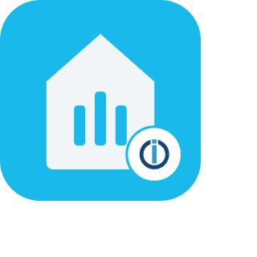

# ioBroker.music-assistant

[](https://www.npmjs.com/package/iobroker.music-assistant)
[](https://www.npmjs.com/package/iobroker.music-assistant)


[](https://nodei.co/npm/iobroker.music-assistant/)

**Tests:** 

## music-assistant adapter for ioBroker

Control Music Assistant players and queues from ioBroker

> **Disclaimer:** This is an unofficial, community-made adapter. It is not affiliated with,
> endorsed by, or supported by the Music Assistant project or the Open Home Foundation.
> "Music Assistant" and its logo are property of their respective owners.

## Prerequisites

- A running [Music Assistant](https://music-assistant.io) server, reachable from your ioBroker host.
- An API token: on the Music Assistant server, go to **Settings → Profile** and create a long-lived token.

## Configuration

In the adapter instance settings, enter:

| Field | Description |
|-------|-------------|
| Host  | Hostname or IP of the Music Assistant server |
| Port  | WebSocket API port (default `8095`) |
| Token | The long-lived API token created above |

## States

For every Music Assistant player, the adapter creates `music-assistant.0.players.<player_id>` with:

| State | Description |
|-------|-------------|
| `available`, `powered`, `playbackState`, `activeSource` | Player status |
| `volume`, `muted` | Writable volume control |
| `mediaTitle`, `mediaArtist`, `mediaAlbum`, `mediaImage`, `elapsedTime` | Now-playing metadata |
| `control.play` / `pause` / `playPause` / `stop` / `next` / `previous` | Writable control buttons |

For every player queue, `music-assistant.0.queues.<queue_id>` gets:

| State | Description |
|-------|-------------|
| `state`, `displayName`, `available`, `currentItemName`, `elapsedTime` | Queue status |
| `shuffleEnabled`, `repeatMode` | Writable queue settings |
| `control.play` / `pause` / `playPause` / `stop` / `next` / `previous` | Writable control buttons |

## For developers

```bash
npm install
npm run build   # compile TypeScript
npm run test    # type-check + package tests
npm run lint    # ESLint
dev-server run  # run against a local test ioBroker instance (see README note below)
```

Note: `dev-server watch` relies on Windows' `wmic.exe` to manage child processes, which newer
Windows 11 builds no longer ship by default. On such machines use `dev-server run` and
start/stop the instance manually from the Admin UI instead.

## Changelog
<!--
    Placeholder for the next version (at the beginning of the line):
    ### **WORK IN PROGRESS**
-->

### 0.0.1 (2026-10-18)
* (M1kad0) initial release

[Older changelogs can be found there](CHANGELOG_OLD.md)

## License
MIT License

Copyright (c) 2026 M1kad0 <leonie+iobroker@sgessinger.de>

Permission is hereby granted, free of charge, to any person obtaining a copy
of this software and associated documentation files (the "Software"), to deal
in the Software without restriction, including without limitation the rights
to use, copy, modify, merge, publish, distribute, sublicense, and/or sell
copies of the Software, and to permit persons to whom the Software is
furnished to do so, subject to the following conditions:

The above copyright notice and this permission notice shall be included in all
copies or substantial portions of the Software.

THE SOFTWARE IS PROVIDED "AS IS", WITHOUT WARRANTY OF ANY KIND, EXPRESS OR
IMPLIED, INCLUDING BUT NOT LIMITED TO THE WARRANTIES OF MERCHANTABILITY,
FITNESS FOR A PARTICULAR PURPOSE AND NONINFRINGEMENT. IN NO EVENT SHALL THE
AUTHORS OR COPYRIGHT HOLDERS BE LIABLE FOR ANY CLAIM, DAMAGES OR OTHER
LIABILITY, WHETHER IN AN ACTION OF CONTRACT, TORT OR OTHERWISE, ARISING FROM,
OUT OF OR IN CONNECTION WITH THE SOFTWARE OR THE USE OR OTHER DEALINGS IN THE
SOFTWARE.